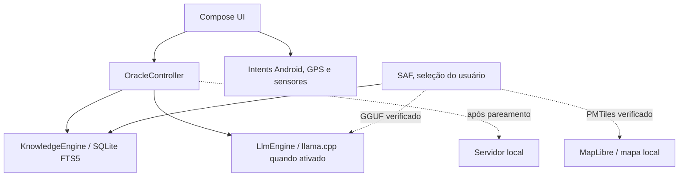

# Oracle OS — arquitetura executável

## Objetivo

APK Android nativo que abre e mantém acesso a comunicação, documentação e localização sem internet, SSD, servidor ou modelo de linguagem. A versão atual usa API 28+ e gera um APK de debug ARM64. O desempenho do modelo Lite foi medido num realme Note 70T de aproximadamente 4 GB.

## Módulos

| Módulo | Responsabilidade | Estado |
| --- | --- | --- |
| `:app` | Compose UI, navegação, intents Android, importação SAF de GGUF/PMTiles e telas de emergência/GPS/sistema | Executável |
| `:core` | Contratos de domínio, modos, capacidades, telemetria, orçamento de memória e seleção de inferência | Testes JVM |
| `:knowledge` | Importação de TXT/Markdown, cópia local íntegra, SQLite FTS5 e citações literais | Executável no telefone |
| `:inference` | llama.cpp JNI para GGUF, carregamento, geração e cancelamento | Executável no telefone |
| `companion/map-pack-builder` | Transformar PBF OSM em PMTiles e assinar pacote de mapa | Pacote de Londres gerado |

O `OracleController` recebe uma pergunta e devolve resultados documentais diretos quando a IA não está ativa. Com um GGUF Lite verificado e memória suficiente, a mesma interface sintetiza uma resposta a partir de trechos recuperados, preservando as referências como fontes recuperadas e avisando que elas não comprovam cada frase gerada. A UI continua acessível quando o modelo falha ou é descarregado.

## Fluxos que já funcionam

1. Instalação e abertura sem rede. O APK inclui um guia básico consultável e legível.
2. Importação de TXT/Markdown via seletor do Android. Os bytes são copiados e indexados em transação. A pesquisa FTS5 devolve trechos literais com título, seção e página apenas quando fornecidos.
3. O discador e o SMS são abertos por intents iniciadas pelo usuário. Nenhuma permissão de chamada/SMS é solicitada.
4. Coordenadas e bússola usam sensores Android quando disponíveis. A permissão de localização é solicitada na tela de mapa.
5. A tela Sistema lê RAM, armazenamento, bateria e condição térmica. Modo Sobrevivência é uma política interna e pode ser revertido na mesma tela.
6. O importador GGUF aceita somente o modelo Lite publicado no manifesto, valida tamanho e SHA-256 e publica o arquivo por movimentação atômica. O motor nativo foi carregado no aparelho de 4 GB e gerou uma resposta à pergunta “GPS” em 22 segundos, com 129 tokens de prompt e 64 de saída.
7. O conversor gerou um PMTiles de Londres de 68.128.278 bytes e um pacote SSD de desenvolvimento assinado. O app importa o PMTiles por SAF, exige o SHA-256 fixado e renderiza a região no MapLibre. A abertura foi validada no telefone com Wi-Fi e dados móveis desligados.
8. O mapa também abriu com o modelo Lite carregado; o processo usou aproximadamente 838 MB de PSS nesse momento.

## Contratos de segurança

- Sem chamada ou SMS automático. Ações de comunicação não usam IA.
- Sem afirmações de risco geográfico em tempo real a partir de GPS/mapa offline.
- Sem citações geradas: apenas títulos e trechos retirados de documentos importados.
- Arquivos externos entram por seleção do usuário e não são executados.
- O builder de pacotes SSD assina Ed25519 e verifica hashes. O importador Android de pacotes assinados ainda precisa ser implementado.
- Servidor futuro só será consultado após pareamento e autorização explícita para dados privados.

## Integração de artefatos baixados

`scripts/download-models.py` baixa por URL fixada, retoma `.part`, verifica tamanho e hash e renomeia para o path final. `data/downloads-manifest.json` registra status e proveniência. O GGUF fica fora do APK e é importado pela aba Sistema. `companion/map-pack-builder/build_map.py` usa um esquema OSM local, gera PMTiles e registra o hash; o app só aceita esse arquivo esperado na aba Mapa.

## Próximos gates

1. Validar cancelamento, descarregamento repetido, bateria baixa e temperatura no aparelho de 4 GB.
2. Ampliar a cobertura de mapas para as demais regiões e adicionar rótulos, busca e roteamento. O pacote atual cobre apenas Londres.
3. Implementar importador Android de pacote SSD assinado com Ed25519 e fallback na remoção.
4. Adicionar PDF/OCR, voz, servidor local e modos avançados conforme permissões e testes reais.

Nenhum item pendente deve ser tratado como capacidade já disponível no APK.
